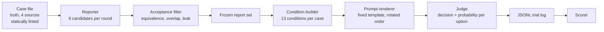
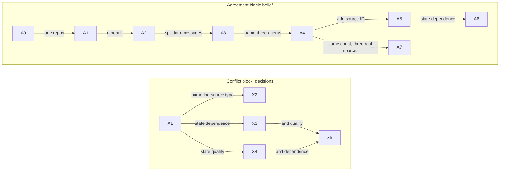

# Counting Reports or Counting Evidence

What provenance an LLM orchestrator needs to discount correlated agent reports.

DSA4213 Natural Language Processing for Data Science, Group 14, Semester 1 AY2026/2027.

New here? Open [`knowledge-graph.html`](knowledge-graph.html) in a browser: an interactive
map of the whole project, where every statement links to the file it comes from.

## Research question

> When several agents report the same claim, can an orchestrating LLM distinguish the
> number of agreeing reports from the number and quality of independent documents
> underlying them, and what information must it be given before it does?

The question has two halves, and the study keeps them apart:

1. **Does the failure happen at all** once the repeated reports are paraphrases rather
   than copies?
2. **Which disclosure repairs it?** Provenance is treated as a graded variable, not as
   something that is either present or absent.

## Why this is an agent problem

In a multi-agent pipeline the orchestrator sees reports, not documents. Agents in one
framework often share a retriever, a tool or a base model, so their outputs are
correlated by construction: one piece of evidence arrives as three apparent witnesses.
An orchestrator that counts them as three independent confirmations becomes confidently
wrong in exactly the situation a multi-agent design is meant to guard against. A single
model reading a single document cannot produce this failure.

The practical question for a system builder is what to put in the message envelope that
passes between agents: a source identifier, a source name, a dependency flag, or a
quality score. Each costs something to plumb through a framework, and we know of no
benchmark that says which of them changes the outcome.

## Setting

Any orchestrator-plus-workers deployment that aggregates reported evidence: research
assistants that fan out sub-queries, triage systems that poll several tools, debate
frameworks that pool agent answers. All of them hand the aggregator reports whose
dependence structure is invisible in the text.

## Related work

Papers live in [`related_works/`](related_works/); the proposal's §2 has the full
discussion and the reference list.

### Where the study sits

| Paper | What it gives us |
|---|---|
| Knowledge conflicts survey, Xu et al. 2024 ([pdf](related_works/knowledge-conflicts-survey.pdf), arXiv 2403.08319) | The name of our setting: **inter-context conflict**. The conflict is between pieces of supplied evidence, not between evidence and what the model already believes. |
| ClashEval, Wu et al. 2024 ([pdf](related_works/clasheval.pdf), arXiv 2404.10198) | The neighbouring case, context against the model's prior: models adopt wrong retrieved content over correct prior knowledge more than 60% of the time. We remove that axis on purpose by using **fictional entities** throughout. |

### The nearest benchmarks, and what each leaves open

| Paper | What it shows | What it leaves open |
|---|---|---|
| RAMDocs / MADAM-RAG, Wang et al. 2025 ([pdf](related_works/ramdocs.pdf), arXiv 2504.13079) | One agent per document, an aggregator combining the debate, and baselines that degrade as the count of documents behind each answer becomes unequal | Every evidence unit is a distinct document, so **report count and source independence move together** and cannot be separated |
| AuthorityBench, Yao et al. 2026 ([pdf](related_works/authoritybench.pdf), arXiv 2603.25092) | Models perceive source authority from the URL alone, and filtering on it helps | Authority is a property of a source, never a statement about the reports in front of the model; whether two documents **share a source** is never stated or varied |
| Whose Facts Win?, Schuster et al. 2026 ([pdf](related_works/whose-facts-win.pdf), arXiv 2601.03746) | A stable credibility hierarchy that repetition reverses, already split into segmentation (gap 33.90 vs 6.17 when merged) and source identity (30.04 under one source) | Repeated evidence is **verbatim copies**, which deduplication would remove; the prompt-level fix fails and the working fix is fine-tuning, so nobody tells the model anything **per trial** |

Whose Facts Win? is why the first two effects we test are *expected* rather than new.
Our version differs in three ways: repeated reports are independently generated
paraphrases, decisions are scored against a known world truth, and the judges are
frontier models.

### Multi-agent aggregation

| Paper | What it shows | Why it matters here |
|---|---|---|
| Multiagent debate, Du et al. 2023 ([pdf](related_works/multiagent-debate.pdf), arXiv 2305.14325) | Debate treats agreeing outputs as corroboration, with single-model accuracy as the baseline | Anchors belief from **one report**, and asks whether **distinct agent identities** add anything |
| Minority Sentinel, He et al. 2026 ([pdf](related_works/minority-sentinel.pdf), arXiv 2606.29270) | In 2-vs-1 debate splits the majority can be wrong; a learned classifier decides when to overturn it | Motivates a **two-against-one** conflict baseline. Its correlation comes from agent errors; ours is built at the evidence source |
| FREE-MAD, Cui et al. 2025 ([pdf](related_works/free-mad.pdf), arXiv 2509.11035) | An LLM judge aggregating agents is prone to conformity, effectively majority voting | Count is not weight. Its failure needs interaction; our agents never interact |
| Peacemaker or Troublemaker, Yao et al. 2025 ([pdf](related_works/debate-sycophancy.pdf), arXiv 2509.23055) | Sycophancy pushes debates into premature consensus | False agreement from another direction, and a limitation to state: we study one aggregation step, not a whole pipeline |

### Provenance and correlated evidence

| Paper | What it shows | How we differ |
|---|---|---|
| When Not to Write Memory, Qi et al. 2026 ([pdf](related_works/correlated-agent-traces.pdf), arXiv 2607.02579) | "Repetition is not evidence"; provenance metadata with dependency-aware grouping estimates effective support | It groups evidence by a dependency structure the **system already knows**. We measure what the **judge** does when nobody tells it, and once it is told |
| CAMA, Lin et al. 2026 ([pdf](related_works/cama.pdf), arXiv 2608.19701) | Memory Correlation Bias: shared upstream sources form a false majority; a trained module infers the effective number of sources | Its fix is a module **outside** the model. Ours is one sentence **inside** the message |
| From Agent Traces to Trust, Wang et al. 2026 ([pdf](related_works/agent-traces-to-trust.pdf), arXiv 2606.04990) | Provenance relations (support, derive, depend-on); provenance through paraphrasing is an open challenge | We do not propose a representation; we test whether a **minimal per-trial statement** is used |

### The gap

Where the work that varies *what the model is shown* sits (proposal Figure 1):

| Form of the repeated evidence | Told nothing | Told source identity or type | Told reports share a source | Told relative quality |
|---|---|---|---|---|
| **Independent paraphrases** | **this project** | **this project** | **this project** | **this project** |
| Verbatim copies | | Whose Facts Win? | | |
| Distinct documents | RAMDocs | AuthorityBench | | |

The top row, reworded reports of one source plus a per-trial statement about dependence
or quality, is unoccupied. And the fixes proposed so far each sit somewhere else:

| Work | Where the fix is applied |
|---|---|
| Whose Facts Win? | **the model**: fine-tune it so it stops over-weighting repetition |
| When Not to Write Memory, CAMA | **the system**: aggregate outside the model |
| Minority Sentinel | **the debate log**: a classifier decides when to overturn the vote |
| This project | **the message**: a statement about the specific reports shown, at inference |

### Controls for other explanations

| Paper | What it shows | The control it motivates |
|---|---|---|
| Explaining Length Bias, Hu et al. 2025 ([pdf](related_works/length-bias.pdf), arXiv 2407.01085) | Length wins only when it adds information: three copies of a response *lose* (50.0 to 13.0 on AlpacaEval) | Report **length** as a trial-level factor, and a cap on length differences within a trial |
| Susceptibility to Influence, Griffin et al. 2023 ([pdf](related_works/llm-susceptibility.pdf), arXiv 2303.06074) | Prior exposure to a statement raises an LLM's later truthfulness rating | **Segmentation** into separate messages gets its own condition |

### Correlation neglect

The quantity we estimate is not new. Correlation neglect, failing to account for
repetition in the information one receives, is formalised by DeMarzo, Vayanos and
Zwiebel (*Persuasion bias, social influence, and unidimensional opinions*, QJE 118(3),
2003) and shown experimentally by Enke and Zimmermann (*Correlation neglect in belief
formation*, REStud 86(1), 2019), both for human decision makers. Measuring it in an LLM
orchestrator, on a benchmark built so the quantity is identifiable, is the
contribution. (Both are journal papers; no PDF is kept here.)

## Hypotheses

H1 and H2 restate effects that prior work already indicates, tested here in a harder
setting. H3 to H6 are the study's own targets.

| | Hypothesis | Status |
|---|---|---|
| H1 | Correlated repetition raises the orchestrator's confidence and can beat a single better-sourced report | Expected from prior work; tested with paraphrases and against ground truth |
| H2 | The rise is driven by report redundancy and segmentation, not by distinct agent identities | Expected from prior work; tested under lexical non-identity |
| H3 | Stating that two reports share a source shifts belief but does not change the decision | **Primary target** |
| H4 | Stating relative source quality does change the decision | **Primary target**, with strength of wording as a factor |
| H5 | Judges infer quality from named source types without being told | Secondary; calibrates against prior work |
| H6 | Forced choice conceals a judge's belief state: where its stated probabilities do not identify the answer it gives (near indifference, or favouring another option), an explicit "cannot be determined" option will be taken when offered | **Primary target** |

**Success** means that for each of H3, H4 and H6 the contrast either shows the predicted
effect, consistent in direction across judges and cases, or rules it out. A null on H3
is as useful as a confirmation: it tells builders a dependency flag alone does not
repair aggregation. The project fails only if the instrument is uninterpretable:
provenance leaking into report text, parse failures, or judges whose stated numbers
carry no information and whose decisions are unstable.

## Contribution

The single claim the design is built to decide: **disclosure about sources changes what
an aggregator believes, while only a statement of relative quality changes what it
chooses.**

1. **The disclosure dissociation.** Dependence, quality, and both, each stated per trial.
2. **Belief versus choice.** A decision *and* a probability for every option, plus an
   abstention arm, so a judge whose numbers disagree with its answer is visible.
3. **Correlated evidence that deduplication does not remove.** Independently generated
   paraphrases that pass an equivalence check and an overlap filter, with provenance
   kept out of the text by construction and by a linter.
4. **Frontier orchestrators**, with a reasoning on/off comparison as optional work.
5. **A quantity, not only accuracy**: the number of independent sources the judge
   behaved as if it saw.

**What we will not claim**: that repeated weaker sources beating one stronger source is
new, that splitting repetition into segmentation and identity is new, or that
majority-following in LLMs is new. Each has a prior anchor above.

## Design

### Task and cases

The orchestrator answers a factual question from one to three agent reports, choosing
among **four options** and giving a probability for every option. Each case fixes:

- a **world truth**, and three strong, independent sources **B, C, D** that support it;
- one weak source **A** whose claim is wrong;
- **two distractors**: plausible values no source supports.

So the options are the truth, A's claim and the two distractors, and every question is
open-valued (a yes/no question cannot carry distractors). All entities are fictional.
Cases cover three domains (institutional logistics, product specifications, incident or
status reports), and source quality is carried by one of four dimensions (authority,
directness, method, primary-source status). How cases are written is in
[`docs/authoring-rules.md`](docs/authoring-rules.md).

### Two agent roles and the pipeline

A **reporter** turns one source into report text; it sees the source's content only,
never who produced it. An orchestrating **judge** reads the reports and decides.
Everything before the judge is generated and frozen once, so the only thing that differs
between conditions is what the judge is shown.



### Two blocks, thirteen conditions

The **agreement block** (A0 to A7) repeats the strong source B, so all reports support the
truth; it measures **belief**. The **conflict block** (X1 to X5) sets two paraphrases of
weak A against one report from strong B, so counting reports gives the wrong answer; it
measures **decisions**. Every condition is a factor vector, stored in each trial record,
so analysis groups by factor rather than by name.

| ID | reports | messages | agents | sources | conflict | provenance shown | dependence stated | quality stated |
|---|---|---|---|---|---|---|---|---|
| A0 | 0 | 0 | 0 | 0 | no | none | no | no |
| A1 | 1 | 1 | 1 | 1 | no | none | no | no |
| A2 | 3 | 1 | 1 | 1 | no | none | no | no |
| A3 | 3 | 3 | 1 | 1 | no | none | no | no |
| A4 | 3 | 3 | 3 | 1 | no | none | no | no |
| A5 | 3 | 3 | 3 | 1 | no | opaque ID | no | no |
| A6 | 3 | 3 | 3 | 1 | no | opaque ID | yes | no |
| A7 | 3 | 3 | 3 | 3 | no | none | no | no |
| X1 | 3 | 3 | 3 | 2 | 2-vs-1 | none | no | no |
| X2 | 3 | 3 | 3 | 2 | 2-vs-1 | named type | no | no |
| X3 | 3 | 3 | 3 | 2 | 2-vs-1 | none | yes | no |
| X4 | 3 | 3 | 3 | 2 | 2-vs-1 | none | no | yes |
| X5 | 3 | 3 | 3 | 2 | 2-vs-1 | none | yes | yes |

In the agreement block each step changes exactly one factor. The conflict block is a
hub: each condition adds one kind of information to the opaque baseline X1, except X5,
which combines two so their joint effect can be compared with each alone.



Three conditions carry extra weight:

- **A0** shows the question with no reports. It gives the judge's prior, the origin of
  the independence index, and a sanity check: with four options it should sit near 25%.
- **A6 and X3 disclose dependence differently, on purpose.** A6 states it on top of the
  identifier A5 introduced, because the agreement ladder adds one element at a time. X3
  states it with no identifier, so X1 against X3 measures the statement alone; it names
  agents, not sources, so it needs no identifier.
- **X1** is the opaque conflict baseline: two reworded reports of the weak source against
  one report of the strong one, nothing else said.

| Contrast | What it isolates | Hypothesis |
|---|---|---|
| A1 → A4 | correlated repetition | H1 |
| A1 → A2 → A3 → A4 | token volume, segmentation, agent identity, one at a time | H2 |
| A4 vs A7 | true independence at equal report count | H2 |
| X1 → X3 | a dependence statement alone | H3 |
| X3 vs X4 vs X5 | dependence against quality | H4 |
| X1 → X2 | a named source type alone | H5 |
| abstention arm | acting on stated uncertainty | H6 |

### Arms

Reports are generated and frozen once, then reused verbatim in every arm. Each arm
varies one thing on top of the conditions above (`pipeline/run.py`, `PROGRAMME`).

| Arm | What it runs | Repeats | Judges | Cases |
|---|---|---|---|---|
| Short | all 13 conditions, accepted paraphrases alone | 6 agreement, 12 conflict | 3 primary | all |
| Abstention | X1-X5 and A7, with a "cannot be determined from the evidence provided" option | 4 | 3 primary | all |
| Confidence screen | 3 single-report trials of rising informativeness (below) | 4 rotations | 3 primary | all |
| Length | X1-X5 and A1, A2 with each paraphrase set in authored filler: 88-96 words, longest at most 1.10 x shortest | 12 conflict, 6 for A1, A2 | Sonnet 5, GPT-5.4 | 10 |
| Wording ladder | W1-W3: X5 with its quality statement softened to *somewhat*, *considerably*, *far* more reliable than the shared source | 12 | 3 primary | the same 10 |

- **Length** crosses the conflict block, where H3 and H4 live, and A1, A2, where H2
  lives: a larger A1 to A2 rise at long length would point to token volume, an equal
  rise to redundancy as such.
- **Abstention** is read against the same judge's abstention rate in A7, where three
  independent sources agree, because models differ hugely in how readily they abstain.
- **The wording ladder** is H4's defence: X5's wording is categorical, so a flip there
  may be compliance. If the weaker rungs also move decisions, the judge is weighing
  evidence.

Presentation order, the slot holding the independent report, the truth's position among
the options, the wrong claim's offset from it, and (long reports) where the operative
sentence sits are **rotated on a fixed schedule, not shuffled**. Twelve repeats give
exact balance over (slot, truth position) and (truth position, wrong offset).

Optional sub-experiments, run in this order if budget allows and **not yet built**: a
reasoning on/off comparison, a wording-robustness rerun with regenerated reports, a
cross-check of stated against token probabilities on the two auxiliary models, and the
independence index at long length.

### Models

| Role | Model |
|---|---|
| Reporter | `google/gemma-4-31b-it`: from a family no judge comes from |
| Equivalence rater | Claude Sonnet 5, which is also a judge: a stated limitation |
| Primary judges | Claude Sonnet 5, GPT-5.4, Claude Opus 5. Temperature 0, reasoning off, each pinned to one serving provider |
| Auxiliary | Qwen 3.6 27B, Llama 4 Maverick: return token probabilities; used only in the optional cross-check |

All access is through OpenRouter. Every trial record stores the model, the serving
provider, token usage and reasoning tokens.

### Measures, in order of weight

1. **Decision against the world truth.** Primary; every claim rests on it.
2. **Decision stability**: the share of a cell's repeats giving its most common answer.
   Read against random answering at that repeat count (about 0.53 at 4 repeats, 0.47 at
   6, 0.41 at 12), not against 0.25.
3. **Stated probability**, within judge, as differences and ranks, never as a
   calibrated quantity across judges.
4. **Abstention rate**, within judge, against its own A7.

Stated probabilities count as evidence only for a judge that passes the **confidence
screen**: *ordering*, where its stated P(truth) rises across an irrelevant report (P0),
a report ruling out two options (P1) and a report naming the answer (P2), tested across
cases with Page's test for ordered alternatives (one-sided p < 0.05, so it needs at
least two cases; both are explained in `docs/methods.md`); and *discrimination*, where
its stated probability separates its correct decisions from its incorrect ones (AUROC,
within condition). A judge that fails is reported as uninformative on confidence; its
decisions still count.

### The independence index

Independent evidence adds in log-odds. With $l(c)$ the logit of the judge's stated
probability on the world truth in condition $c$:

$$n_\text{eff}(c) = \frac{l(c) - l(A0)}{l(A1) - l(A0)}$$

the number of independent sources the judge behaved as if it saw. Normatively
$n_\text{eff}(A4) = 1$ (three reports, one source) and $n_\text{eff}(A7) = 3$ (three
sources), so $n_\text{eff}(A4) - 1$ is credited independence that does not exist and
$n_\text{eff}(A4) - n_\text{eff}(A6)$ is what a dependence statement claws back. It is
undefined where one report moves the judge by less than 0.2 logits, an anomaly where it
moves belief the wrong way, and reported only for judges that pass the screen.

### What counts as support, fixed before any data

| Comparison | Support | Clean null | A nuisance variable is driving it if |
|---|---|---|---|
| A1 → A4 (H1) | belief in the repeated claim rises in the same direction in most case-by-judge cells | no consistent direction | the rise appears in one domain only, or only at particular positions |
| A2, A3, A4 (H2) | A3 and A4 exceed A2 and differ little from each other | all three within noise | the A1 → A2 effect is larger at long length than at short |
| X1 → X3 (H3) | belief moves toward the truth while the decision rate is unchanged | neither moves | movement only where a mild content cue survives |
| X3, X4, X5 (H4) | X4 and X5 change decisions where X3 does not | X4 and X5 behave like X3 | decisions change only under the strongest wording |
| X1 → X2 (H5) | accuracy rises with a named source type alone | no change from X1 | the gain appears only for types matching a familiar real institution |
| Abstention (H6) | abstention concentrates where stated probabilities do not identify the answer given | abstention flat across conditions, A7 included | one judge abstains everywhere or nowhere |

## Running the study

Needs [uv](https://docs.astral.sh/uv/). Nothing in this first block calls an API.

```bash
uv sync                                   # install requests and pytest into .venv
uv run pytest                             # the test suite, with sockets disabled
uv run python -m pipeline.lint            # check every case against the authoring rules
uv run python -m pipeline.run dry         # the whole programme on the mock backend
uv run python -m pipeline.run plan        # pre-flight call and cost estimate
uv run python -m pipeline.run plan --cases 40    # ... for the full corpus
```

The test suite also checks the knowledge graph (`tools/check_graph.py`). Quotes from PDFs
are verified with `pdftotext` (poppler); without it they are skipped with a warning.

The real steps spend money. Each needs the group's approval first, and each takes a hard
call ceiling. Put the key in `.env` (copy `.env.example`; `.env` is git-ignored).

```bash
uv run --env-file .env python -m pipeline.run balance       # the key's limit and usage
uv run --env-file .env python -m pipeline.run probe         # do the models resolve? pinned providers? logprobs?
uv run --env-file .env python -m pipeline.run generate --max-calls N     # N: 120 per case covers two rounds
# now read runs/frozen_reports.json by hand: cue survival, same denominator for A and B
uv run --env-file .env python -m pipeline.run judge --max-calls N        # N: the judge calls plan reports
uv run python -m pipeline.score runs/trials.jsonl
```

`judge --arms conflict,abstain --log trials-1.jsonl` runs part of the programme into its
own log; `pipeline.score` accepts several logs at once. A run stops itself on its call
ceiling, a failed call, a pinned judge served by another provider, more than one parse
failure in its first 50 trials, or a frozen report that fails the leak check.

| Output in `runs/` | What it holds |
|---|---|
| `probe.json` | one call per model: provider, logprobs, errors |
| `frozen_reports.json` | the accepted reports, with their acceptance scores |
| `generation_report.json` | every candidate, accepted or the reason it was rejected; calls per source |
| `generation_calls.jsonl` | every reporter and rater call |
| `trials.jsonl` | one record per judge call: the trial, the raw reply, the parse, provider, usage |

Real outputs are evidence: they are never overwritten, and they are committed. Dry runs
write to `runs/mock/`, which is ignored.

## Repository layout

```
README.md                 this file
knowledge-graph.html      the project map; content is the JSON block near the end
CLAUDE.md                 how agents keep the map current
docs/
  proposal.pdf            the submitted proposal
  authoring-rules.md      how to write a case, and what a reviewer checks
  decisions.md            why the code is the way it is, and what is still open
  methods.md              how each statistical method works, with worked examples
  work-plan.md            who does what next, in small steps, for newcomers
related_works/            the papers in the related-work section
cases/                    the corpus: one module per case, registered in __init__.py
pipeline/
  llm.py                  OpenRouter and mock backends
  reporter.py             generation, acceptance filter, freezing
  conditions.py           the conditions, the ladder, rotations, the screen
  prompt.py               the judge prompt
  judge.py                judge calls, reply parsing, trial records
  score.py                the scorer
  lint.py                 static checks on the cases
  run.py                  the command line and the programme
tests/                    offline tests, plus a deliberately broken case fixture
tools/check_graph.py      checks every quote in the map against its file
runs/                     outputs of real runs (created by the first run)
```

## Status and open items

Who does what next, step by step: [`docs/work-plan.md`](docs/work-plan.md).

- **Corpus: 3 of 40 cases.** M1 (institutional logistics, authority, T2), M4 (product specification, method, T1) and M5 (incident status, authority, T1). 
  Authoring and independent review are the critical
  path; see `docs/authoring-rules.md`.
- **No real run has happened in this repository.** `runs/` fills from the first
  `generate`.
- **Pilot: 5 of the 40 cases**, the fewest at which one badly ordered case cannot fail a
  judge on the confidence screen by itself (`docs/decisions.md`). Three more cases must be
  written and reviewed first. Which arms the pilot runs, and its call ceiling, are not
  decided yet.
- **Open before the main run** (each recorded in `docs/decisions.md`):
  - review the wording ladder's sentence: the proposal fixes its three intensity words,
    not the full sentence;
  - choose the ten cases for the length arm and the ladder (the code takes the first ten);
  - set the discrimination check's pass mark and smallest usable class size;
  - set the margin below which H6 counts a judge as indifferent (the proposal says "a
    stated threshold"; none is stated yet; the margin itself is already logged).
- **Not built**: the four optional sub-experiments. The backend already supports the
  reasoning switch and token logprobs they need.
